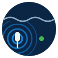

<div align="center">



# legacy-CSUB

<sub>underwater communication · 2016 to 2017 · LIOC, COPPE/UFRJ · <a href="#what-it-needs">what it needs</a> · <a href="#how-to-cite">cite</a></sub>

[](#archive-notice)
[-FFDB00?style=flat-square)](#what-it-needs)
[](#what-it-needs)
[](.github/workflows/tests.yml)
[](#about-the-text)

</div>

> [!WARNING]
> **Archive notice.** This repository is not maintained. Do not use it as a base for new work.
> It is a record of my part in an underwater communication program. The Brazilian Navy and
> LIOC (COPPE/UFRJ) did this program together. Luiz Felipe Moraes
> ([@lfelipem](https://github.com/lfelipem)) was my advisor.

## in one minute

- **CSUB sends and receives signals under water.** It is a LabVIEW project for a CompactRIO
  controller. The controller is an NI cRIO-9068.
- **The FPGA makes and reads the signals.** The FPGA writes the transmit signal to an analog
  output module. It reads the receive signal from an analog input module.
- **The real-time (RT) side controls the FPGA.** It sets the frequency and the amplitude. It
  records the received data in TDMS files.
- **A computer shows the data.** The user interface (UI) on the computer connects to the RT side.
  It shows the data and sends commands.
- **The work stopped in March 2017.** The last commit integrates the three stages: reception,
  transmission and supervision.

## where to start

| If you want to | Go to |
|---|---|
| open the project | `CSUB LabVIEW Project.lvproj` |
| see the FPGA code | `FPGA Main.vi` |
| see the real-time code | `RT Main.vi` and `RT Loops/` |
| see the user interface | `UI Main.vi` |
| change the acquisition settings | `Config.xml`, or `Utility - Configuration File Generator.vi` |
| read the development log | [`documentation/logdesenvolvimento.pdf`](documentation/logdesenvolvimento.pdf) |
| find the software that you must install | [what it needs](#what-it-needs) |
| do the checks | [tests](#tests) |

## how it works

The project has three parts. Each part runs on a different processor.

| Part | Runs on | Main VI | What it does |
|---|---|---|---|
| FPGA | the FPGA of the cRIO-9068 | `FPGA Main.vi` | It makes the transmit signal and reads the receive signal. |
| RT | the ARM processor of the cRIO-9068 | `RT Main.vi` | It controls the FPGA, records TDMS files and monitors the system. |
| UI | a Windows computer | `UI Main.vi` | It shows the data and sends commands to the RT side. |

The RT side has four loops. Each loop is in `RT Loops/`:

1. **Acquisition and Logging.** This loop reads the data from the FPGA and writes TDMS files.
2. **UI Commands.** This loop receives the commands from the UI.
3. **System Health and FPGA Monitoring.** This loop monitors the controller and the FPGA.
4. **Watchdog.** This loop restarts the controller if the software stops.

The RT side sends data to the UI through network streams. The two sides send messages through
message queues (`support/Message Queue/`).

The structure of the project comes from an NI sample project. Its name is "LabVIEW FPGA
Waveform Acquisition and Logging on CompactRIO". Its guide is in `documentation/`. NI wrote that
guide. We did not write it.

### the modules

The project file names these C Series modules:

| Module | Type |
|---|---|
| NI 9239 | analog input |
| NI 9269 | analog output |
| NI 9381 | multifunction input and output |

### the history

The table shows the main steps. The source of each step is its commit message.

| Date | Commit | Step |
|---|---|---|
| 2016-12-01 | `Versão Inicial` | first version of the project |
| 2017-01-10 | `TDMS Simples funcionando` | the TDMS recording works |
| 2017-02-01 | `Versão Entrega Parcial Recepção` | partial delivery of the reception |
| 2017-02-07 | `Primeira Entrega Transmissão` | first delivery of the transmission |
| 2017-02-13 | `Transmissão com frequência, amplitude e alta precisão.` | transmission with a set frequency and amplitude |
| 2017-02-20 | `Início etapa de Supervisão` | start of the supervision stage |
| 2017-03-06 | `Versão 3 etapas funcionando` | the three stages work together |
| 2017-03-22 | `v1.22CSUB LabVIEW Project` | last version |

## what it needs

The project was saved in LabVIEW 2016 (version 16.0). You must have this NI software:

- LabVIEW 2016 or a later version
- the LabVIEW Real-Time Module
- the LabVIEW FPGA Module
- NI-RIO, with the support for the cRIO-9068
- the drivers for the NI 9239, NI 9269 and NI 9381 modules

The project also uses these parts of `vi.lib`: the RT watchdog, the analysis library, the XML
and file utilities, the WebDAV client and the system configuration library (`nisyscfg`).

One VI comes from an NI example. The example is not in this repository. Its path is
`examples/CompactRIO/Module Specific/NI 9381/NI 9381 Advanced IO/Create AO Sine Waves (SubVI).vi`.
LabVIEW installs it with the NI 9381 examples.

### to open the project in a later LabVIEW version

The VIs are binary files. Only LabVIEW can convert them. We did not do this conversion.

1. Install the later LabVIEW version, the two modules and NI-RIO.
2. Open `CSUB LabVIEW Project.lvproj`.
3. If LabVIEW cannot find the NI 9381 example VI, browse to it.
4. Do a mass compile of the project folder.
5. Compile the FPGA VI again. The bitfiles in `FPGA Bitfiles/` are for LabVIEW 2016 only.
6. Save the project.

> [!CAUTION]
> Do not install new software on the cRIO-9068 before you make a backup of the controller.

## tests

The VIs are binary files. Thus the tests cannot run the VIs. The tests check the repository:

- the project files, the libraries, `Config.xml` and the bitfiles are valid XML
- each file that the project names is in the repository, or it is the NI example above
- each VI and each control has the LabVIEW file header
- the project files contain no IP addresses and no web services key
- the README has the archive notice, and its sentences are not too long

To do the checks, use this command. You must have Python 3.9 or later.

```sh
python3 -m unittest discover -s tests -v
```

The workflow `.github/workflows/tests.yml` does the same checks.

## about the text

The text in this README follows ASD-STE100, Simplified Technical English, Issue 9. The
[tests](#tests) check one rule only: the length of a sentence. A person must check the other
rules and the dictionary. The VIs, the commit messages and the files in `documentation/` do not
follow ASD-STE100.

## authors

- Rafael Mazza
- Luiz Felipe Moraes ([@lfelipem](https://github.com/lfelipem)), advisor
- Matheus Hoffmann ([@h0ffmann](https://github.com/h0ffmann))

The original repository is `lioc-coppe/CSUB`. It is private. This repository is a copy of it,
with its full history. Before we published the copy, we removed the IP addresses and the web
services key from all the commits.

## how to cite

This repository has no DOI. Cite it as software:

> Mazza, R., Moraes, L. F., & Hoffmann, M. (2017). *CSUB: underwater communication on CompactRIO*
> [Computer software]. https://github.com/h0ffmann/legacy-CSUB

My other works with a DOI:

- marola: [10.5281/zenodo.23224155](https://doi.org/10.5281/zenodo.23224155)
- ww3-gpu: [10.5281/zenodo.23221351](https://doi.org/10.5281/zenodo.23221351)
- picasso: [10.5281/zenodo.23311208](https://doi.org/10.5281/zenodo.23311208)
- closed source: [10.5281/zenodo.23333656](https://doi.org/10.5281/zenodo.23333656)
- marola-bench: [10.5281/zenodo.23352633](https://doi.org/10.5281/zenodo.23352633)
- nashkell, the open book: [10.5281/zenodo.23356739](https://doi.org/10.5281/zenodo.23356739)

## licensing

This repository has no licence. All rights stay with the authors. The NI guide in
`documentation/` and the parts of the NI sample project stay under the terms of NI.

LabVIEW, CompactRIO and NI are trademarks of National Instruments Corporation (now part of
Emerson).
